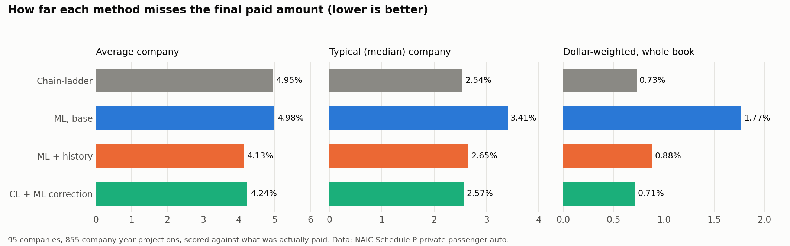
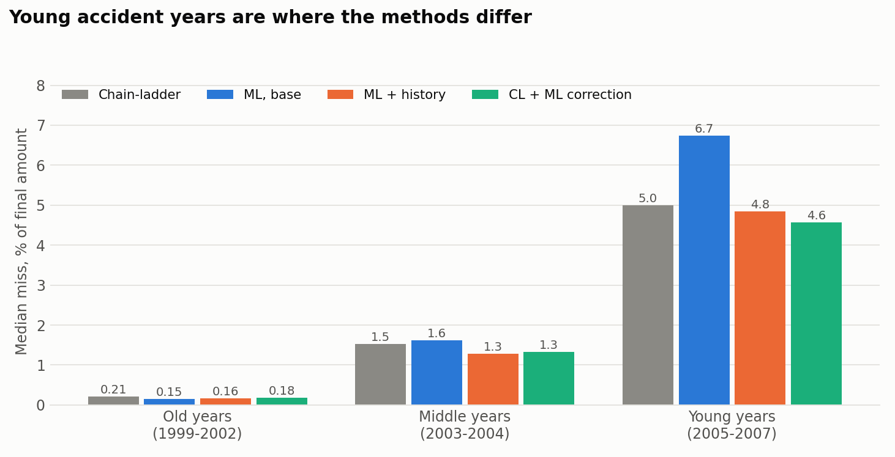

# Can machine learning beat the chain-ladder at insurance loss reserving?

An end-to-end test on real data. For 95 US insurers, I project how much each accident year will finally cost, using the industry-standard chain-ladder method and three machine-learning variants, and then compare the projections with what was actually paid.

**Live app:** [insurance-loss-reserving.streamlit.app](https://insurance-loss-reserving.streamlit.app/)



## The question

Insurers set aside money (a reserve) for claims that have happened but are not fully paid yet. The standard way to estimate it is the chain-ladder: look at how past years' payments grew from one year to the next and apply the same growth to the years still open. It is simple and hard to beat. This project asks whether a machine-learning model can do better, and measures it honestly.

## Data

- NAIC Schedule P, private passenger auto, from the [Casualty Actuarial Society Loss Reserving Database](https://www.casact.org/publications-research/research/research-resources/loss-reserving-data-pulled-naic-schedule-p).
- 143 companies in the file, 121 with a full 10 by 10 triangle, 95 used for modelling.
- Accident years 1998 to 2007, followed for 10 years. Everything is valued at the end of 2007, and the truth is cumulative paid loss at development lag 10.
- Amounts are in thousands of US dollars.

## Method

| Method | What it does |
|---|---|
| Chain-ladder (CL) | Volume-weighted age-to-age factors, the benchmark |
| Bornhuetter-Ferguson (BF) | Blends chain-ladder with an expected loss ratio from the 5 oldest years |
| ML, base features | Gradient boosting predicts the next step of growth from lag, paid-to-premium, prior growth and premium |
| ML + company history | Adds each company's own history of growth |
| CL + ML correction | Starts from chain-ladder's growth and lets the model learn the correction |

Design choices that keep the test fair:

- **No leakage.** The models predict the next development step only from cells known at the valuation date, and are trained and tested with calendar-year splits (targets up to 2005, 2006 and 2007). The final choice between variants was set by a rule written down before looking at the results.
- **Scored once.** The final projections are scored a single time.
- **Only genuine projections are scored.** Accident year 1998 is already fully paid at the end of 2007, so its 95 rows are left out. That leaves 855 projections.
- **Uncertainty.** Differences against chain-ladder come with 95% paired bootstrap intervals over companies.

## Results

Average miss per company, as an absolute percentage of the final paid amount at lag 10 (lower is better):

| Method | Mean miss % | Median miss % | Beats chain-ladder in |
|---|---|---|---|
| Chain-ladder | 4.95 | 2.54 | n/a |
| Bornhuetter-Ferguson | 6.65 | 3.11 | 43% of companies |
| ML, base features | 4.98 | 3.41 | 47% |
| ML + company history | **4.13** | 2.65 | 59% |
| CL + ML correction | 4.24 | 2.57 | 61% |

What this says:

- Machine learning on the same basic inputs as chain-ladder does **not** beat it (4.98 against 4.95).
- Giving the model each company's own history helps: 0.82 points lower on average, with a 95% interval of 0.32 to 1.40 points better than chain-ladder.
- The correction approach reaches almost the same gain (0.71 points, interval 0.35 to 1.11). The two are statistically a tie.
- Chain-ladder is not beaten everywhere. At the median company it is as good as the ML models, and weighted by dollars it is already very accurate (0.73%). The gain comes from the harder cases, mostly small and young accident years.
- Added up, the net error in the reserve still to be paid is +0.70% for chain-ladder, -4.34% for ML + history and -1.31% for the correction model.



## Limits

- One valuation date (end of 2007), one line of business, 95 companies.
- Size-tier results are exploratory, with about 32 companies per tier.
- Chain-ladder here is the plain textbook version. Practitioners adjust it with judgement, which a script does not.
- This is a portfolio study, not reserving advice.

## Run it yourself

```
python -m venv sqlenv
sqlenv\Scripts\activate
pip install -r requirements-pipeline.txt

python 01_data_setup.py
python 02_benchmark.py
python 03_one_step_tests.py
python 04_ultimate_projection.py
python 05_scorecard.py
python 06_export_app_data.py

pip install -r requirements.txt
streamlit run app.py
```

The repository already includes `app_data/`, so the app runs without redoing the pipeline: install `requirements.txt` and run `streamlit run app.py`.

## Files

| File | Purpose |
|---|---|
| `01_data_setup.py` | Load the CSV into SQLite, run data-quality checks, build the feature view |
| `02_benchmark.py` | Chain-ladder and Bornhuetter-Ferguson for every company |
| `03_one_step_tests.py` | Compare ML variants on one-step predictions, with rolling calendar splits |
| `04_ultimate_projection.py` | Project each accident year to lag 10 with every method |
| `05_scorecard.py` | Scorecard, bootstrap intervals and charts |
| `06_export_app_data.py` | Write the data files the app reads |
| `app.py`, `viz.py` | Streamlit app and its charts |
| `chain_ladder.py`, `ml_core.py`, `scoring.py` | Shared maths, features and scoring |
| `app_data/`, `charts/` | Outputs the app and this page use |

## Tools

Python, SQL (SQLite window functions for the features), pandas, scikit-learn, Plotly, Streamlit.

## Author

Ahmad Nawaz, Bournemouth, UK. [LinkedIn](https://www.linkedin.com/in/ahmad-nawaz-16684130b)